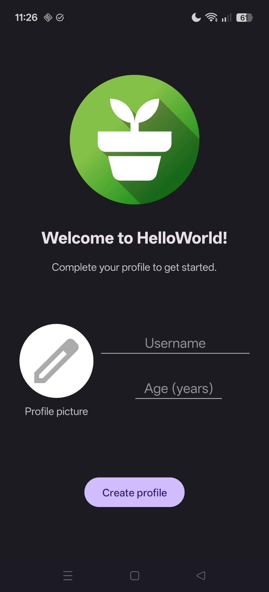
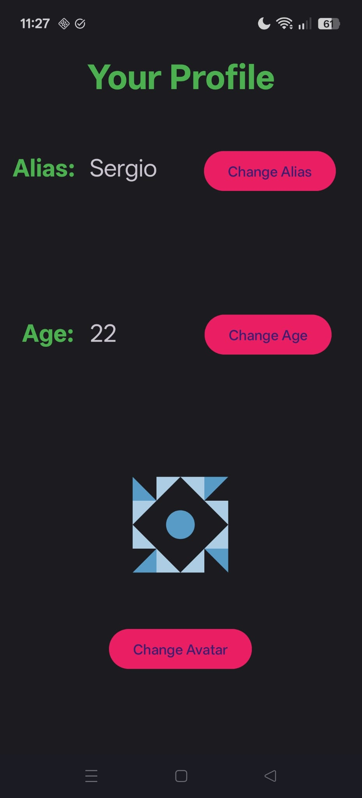

# HelloWorldMAD26

## Members
- Sergio Pastor Mesas (bt0385) ([GitHub](https://github.com/bt0385))
- Gabriel Gutiérrez Fuentes (bt0055) ([GitHub](https://github.com/gabrielgutierrezfuentes))

## Links
GitHub:
- Repository: https://github.com/bt0385/HelloWorldMAD26
- Releases: https://github.com/bt0385/HelloWorldMAD26/releases

Sharepoint:
- Landing page: https://upm365.sharepoint.com/sites/MAD26GS/SitePages/Home.aspx
- Tracking: https://upm365.sharepoint.com/sites/MAD26GS/SitePages/Tracking.aspx

## Description
This repository contains a basic Android app, which contains three Activities
and a basic navigation system to switch between them. The code is based on
Android Studio's "Empty Views Activity" template.

The objective of this repository is to act as a foundation for further
application development.

## Changelog

### Week 1 ([release](https://github.com/bt0385/HelloWorldMAD26/releases/tag/w1.2026))
- Created Sharepoint page.
- Created GitHub repository.
- Created Hello World app.

### Week 2 ([release](https://github.com/bt0385/HelloWorldMAD26/releases/tag/w2.2026))
- Created `SecondActivity` and `ThirdActivity`.
- Added basic navigation system between activities.

### Week 3 ([release](https://github.com/bt0385/HelloWorldMAD26/releases/tag/w3.2026))
- Added capability to show latitude and longitude of current location in `MainActivity`.
- Added logging in `MainActivity`, `SecondActivity` and `ThirdActivity`.
- Created `OpenStretMapsActivity`, which shows in a map, with a marker, your current location.
- Added markers in UPM buildings (see in OpenStreetMaps).

### Week 4 ([release](https://github.com/bt0385/HelloWorldMAD26/releases/tag/w4.2026))
- Created new activity (`LandingActivity`) for users launching the app for the first time.
- Modified `MainActivity` with a text welcoming the user and the `SecondActivity` button now letting you go to `ProfileActivity`.
- Modified `SecondActivity`, now called `ProfileActivity` so that the user can see and change his/her profile parameters.
- Implemented a "Shared Preferences" persistence system to save the data inputed by the user in the `LandingActivity` and `ProfileActivity`.
- Added a drawer menu in the `MainActivity` and `ProfileActivity` for better navigation.
- IMPORTANT: Now the activities finish when the user leaves them. To go back, use the side menu or the buttons.

## Screenshots of the App

|  |  |  |  |  |
|:----------------------------------------------------:|:----------------------------------------------------:|:------------------------------------------------------------------------:|:--------------------------------------------------------:|:-------------------------------------------------------:
|                   *Landing Activity*                    |                   *Main Activity*                    |                          *OpenStreetMaps Activity*                       |                    *Second Activity*                     |                  *Third Activity*                      |
