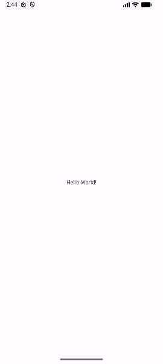

# HelloWorldMAD26

## Members
- Sergio Pastor Mesas (bt0385) ([GitHub](https://github.com/bt0385))
- Gabriel Gutiérrez Fuentes (bt0055) ([GitHub](https://github.com/gabrielgutierrezfuentes))

## Links
GitHub:
- Repository: https://github.com/bt0385/HelloWorldMAD26
- Releases: https://github.com/bt0385/HelloWorldMAD26/releases

Sharepoint:
- Landing page: https://upm365.sharepoint.com/sites/MAD26GS/SitePages/Home.aspx
- Tracking: https://upm365.sharepoint.com/sites/MAD26GS/SitePages/Tracking.aspx

## Description
This repository contains an example Kotlin application which shows "Hello World"
when launched. The code is based on Android Studio's "Empty Views Activity"
template.

The objective of this repository is to act as a foundation for further
application development.

## Screenshots
|  |
|:--:|
|*MainActivity.kt*|*Inside app*|

|  |
|:--:|
|*Main app view*|
