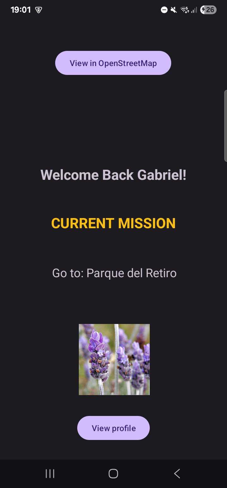
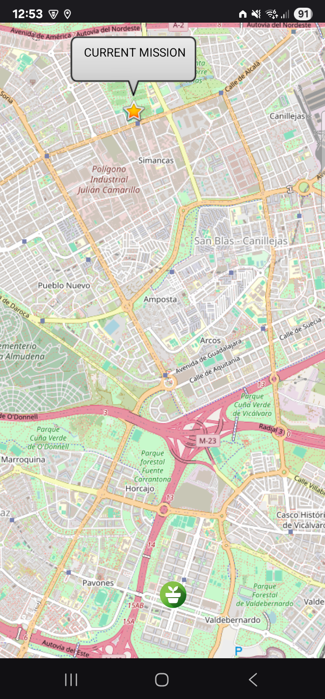
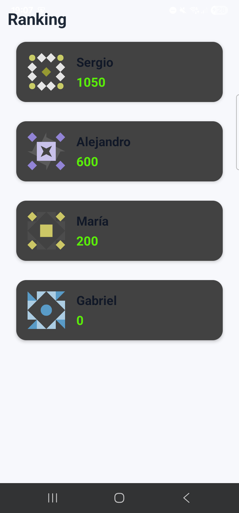

# BioBond

## Members
- Sergio Pastor Mesas (bt0385) ([GitHub](https://github.com/bt0385))
- Gabriel Gutiérrez Fuentes (bt0055) ([GitHub](https://github.com/gabgutf))

## Links
GitHub:
- Repository: https://github.com/bt0385/HelloWorldMAD26
- Releases: https://github.com/bt0385/HelloWorldMAD26/releases

Sharepoint:
- Landing page: https://upm365.sharepoint.com/sites/MAD26GS/SitePages/Home.aspx
- Tracking: https://upm365.sharepoint.com/sites/MAD26GS/SitePages/Tracking.aspx

## Description
BioBond is an app that encourages users to go out and discover new places.
By gamifying the act of walking, it empowers user to explore their home city.

## Screenshots of the App

|  |  |  |  |  |
|:-----------------------------------------------------------:|:----------------------------------------------------:|:-----------------------------------------------------------------------:|:-----------------------------------------------------------:|:--------------------------------------------------------:|
|                     *Landing Activity*                      |                   *Main Activity*                    |                        *OpenStreetMaps Activity*                        |                     *Profile Activity*                      |                    *Ranking Activity*                    |

## Demo video
[Click here](https://upm365-my.sharepoint.com/:v:/g/personal/sergio_pastor_alumnos_upm_es/IQBRL6zR2-ZRQq4iCjdHVVhAAe-M0jumzLC_r58ICXSyqJY?e=LTUDQd&nav=eyJyZWZlcnJhbEluZm8iOnsicmVmZXJyYWxBcHAiOiJTdHJlYW1XZWJBcHAiLCJyZWZlcnJhbFZpZXciOiJTaGFyZURpYWxvZy1MaW5rIiwicmVmZXJyYWxBcHBQbGF0Zm9ybSI6IldlYiIsInJlZmVycmFsTW9kZSI6InZpZXcifX0%3D)

## Features
- Persistence in SharedPreferences.
- Persistence in remote backend.
- Custom REST [API](https://www.openapiviewer.com/view/2026-04-18T17-30-13-960Z--4648a80435f8ee8b1e3322febb09f3aac772554786bf26a1a19d120e467db09b--api-spec-yaml#?route=overview).
- OpenStreetMap maps.
- Side navigation menu.
- GPS location.
- Remote image loading with Glide.

## How to use
### App
To use the BioBond app, follow these instructions:
1. Install the app.
2. Create an account. Choose a username and profile picture.
3. Choose one of the three plants offered. The type of plant you choose will influence what type of missions you get.
4. The app will automatically generate a random mission, if you go to that location, you'll earn some points.

You can check the global rankings, as well as edit your profile at any time by swiping left and opening the navigation menu.

### API server
To run your own instance of the API server, you must do the following:
1. Clone the BioBond repository.
2. Install Python and the required dependencies (see [`pyproject.toml`](https://github.com/bt0385/HelloWorldMAD26/blob/68778423bab6b56f201ed2caecb8ac979a820e97/server/pyproject.toml#L15-L22))
3. Start the server by running `python src/main.py --db {DB_PATH}` from the `server/` directory.

To instruct the app to use your custom server, modify the `BASE_URL` variable in [`RetrofitInstance`](https://github.com/bt0385/HelloWorldMAD26/blob/68778423bab6b56f201ed2caecb8ac979a820e97/app/src/main/java/es/upm/etsisi/mad/helloworld/api/RetrofitInstance.kt#L12).

## Changelog

### Week 1 ([release](https://github.com/bt0385/HelloWorldMAD26/releases/tag/w1.2026))
- Created Sharepoint page.
- Created GitHub repository.
- Created Hello World app.

### Week 2 ([release](https://github.com/bt0385/HelloWorldMAD26/releases/tag/w2.2026))
- Created `SecondActivity` and `ThirdActivity`.
- Added basic navigation system between activities.

### Week 3 ([release](https://github.com/bt0385/HelloWorldMAD26/releases/tag/w3.2026))
- Added capability to show latitude and longitude of current location in `MainActivity`.
- Added logging in `MainActivity`, `SecondActivity` and `ThirdActivity`.
- Created `OpenStretMapsActivity`, which shows in a map, with a marker, your current location.
- Added markers in UPM buildings (see in OpenStreetMaps).

### Week 4 ([release](https://github.com/bt0385/HelloWorldMAD26/releases/tag/w4.2026))
- Created new activity (`LandingActivity`) for users launching the app for the first time.
- Modified `MainActivity` with a text welcoming the user and the `SecondActivity` button now letting you go to `ProfileActivity`.
- Modified `SecondActivity`, now called `ProfileActivity` so that the user can see and change his/her profile parameters.
- Implemented a "Shared Preferences" persistence system to save the data inputed by the user in the `LandingActivity` and `ProfileActivity`.
- Added a drawer menu in the `MainActivity` and `ProfileActivity` for better navigation.
- IMPORTANT: Now the activities finish when the user leaves them. To go back, use the side menu or the buttons.

### Week 5 ([release](https://github.com/bt0385/HelloWorldMAD26/releases/tag/w5.2026))
Implemented the following changes:
- Implemented mission system.
    - Generates missions around the user.
    - Checks the location of the user.
    - Clears the mission and notifies the user if they are close enough.
- Refactoring and code cleanup.
  - Added `AppActivityState`, which stores common state shared by most activities.
  - Implemented `PermissionManager` to simplify permission requests.
  - Added `NavigationActivityHelper` to manage the navigation drawer.
  - Implemented `UserLocationManager` and `LocationActivityHelper` to simplify location management.

Fixed the following issues:
- [#11](https://github.com/bt0385/HelloWorldMAD26/issues/11) `OpenStreetMapActivity` does not show current location unless launched from `MainActivity`.
- [#12](https://github.com/bt0385/HelloWorldMAD26/issues/12) Cannot navigate out of `OpenStreetMapActivity` without closing app.
- [#13](https://github.com/bt0385/HelloWorldMAD26/issues/13) Create utility class for navigation drawer.
- [#14](https://github.com/bt0385/HelloWorldMAD26/issues/14) Remove negative age check from `LandingActivity`.
- [#15](https://github.com/bt0385/HelloWorldMAD26/issues/15) Mission system.
- [#16](https://github.com/bt0385/HelloWorldMAD26/issues/16) Show current mission on map.
- [#17](https://github.com/bt0385/HelloWorldMAD26/issues/17) Show mission location on `MainActivity`.
- [#18](https://github.com/bt0385/HelloWorldMAD26/issues/18) Create state class.

Related pull requests:
- [#19](https://github.com/bt0385/HelloWorldMAD26/pull/19) Week 5 Mission Generator
- [#20](https://github.com/bt0385/HelloWorldMAD26/pull/20) Refactor location, navigation and permission systems into helper classes
- [#21](https://github.com/bt0385/HelloWorldMAD26/pull/21) Merge week 5 changes to master

### Final version ([release](https://github.com/bt0385/HelloWorldMAD26/releases/tag/final))
Implemented the following changes:
- Implemented server API.
  - Keeps track of user accounts.
  - Allows viewing and updating global rankings.
  - Implemented plant system with different necessities.
  - Updated mission generation system.
